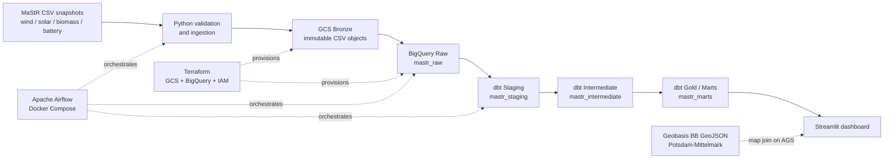
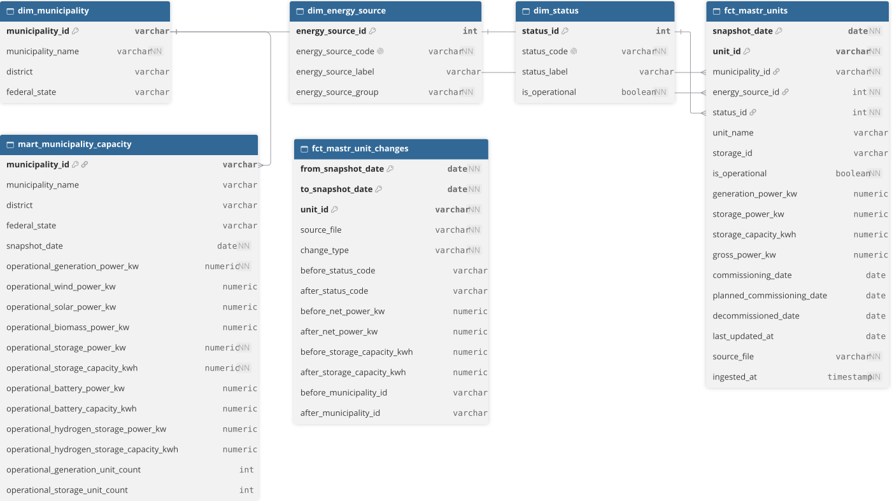

# MaStR Renewable Energy Data Engineering

End-to-end data product for [Marktstammdatenregister (MaStR)](https://www.marktstammdatenregister.de/) extracts covering **Potsdam-Mittelmark** (Brandenburg, Germany): wind, solar, biomass, and battery storage across **38 municipalities**.

**Business question:** Which municipalities have high renewable generation capacity relative to battery storage capacity?

This monorepo implements a reproducible medallion-style pipeline (Bronze → Raw → Staging → Intermediate → Gold), orchestrated with Apache Airflow, provisioned with Terraform, and explored through a Streamlit dashboard with Brandenburg municipality boundaries.

---

## Architecture

CSV snapshots are supplied **manually** under `mastr-data-pipeline/data/raw/<snapshot_date>/`. Automated MaStR export download is not implemented. Airflow runs are **manual** (`schedule=None`).

For a fuller stage-by-stage status table, see [mastr-data-pipeline/docs/architecture.md](mastr-data-pipeline/docs/architecture.md).

---

## Technology stack

| Area | Technologies |
|---|---|
| Ingestion & validation | Python 3.12, Poetry |
| Cloud storage & warehouse | Google Cloud Storage (Bronze), BigQuery (`europe-west3`) |
| Transforms | dbt (BigQuery) |
| Orchestration | Apache Airflow 2.x, Docker Compose, LocalExecutor |
| Infrastructure | Terraform (Google provider) |
| Dashboard | Streamlit, Altair, PyDeck; Geobasis BB OGC API for GeoJSON |
| Auth (local / Compose) | Application Default Credentials (keyless; no SA JSON keys in-repo) |

---

## Repository structure

| Directory | Responsibility |
|---|---|
| [`mastr-data-pipeline/`](mastr-data-pipeline/) | Python package, Data Contract, GCS Bronze upload, BigQuery Raw load, dbt models/tests/seeds, data docs |
| [`mastr-airflow/`](mastr-airflow/) | Airflow Docker Compose stack and DAG that orchestrates the pipeline (no business SQL) |
| [`mastr-infra/`](mastr-infra/) | Terraform for Bronze bucket, BigQuery datasets, and additive runtime IAM |
| [`mastr-dashboard/`](mastr-dashboard/) | Streamlit PoC: Gold KPIs, charts, and choropleth map |

Each application component keeps its own Poetry environment, Makefile (where present), and README. Credentials and dbt profiles stay outside the repository under the operator home directory.

---

## Data modelling

Layering follows **Raw → Staging → Intermediate → Gold**:

| Layer | Dataset (product contract) | Role |
|---|---|---|
| GCS Bronze | Bucket objects | Immutable original CSV bytes, path-labeled by `snapshot_date` |
| BigQuery Raw | `mastr_raw` | Four tables: `raw_mastr_wind` / `_solar` / `_biomass` / `_storage` |
| Staging | `mastr_staging` | Four views; DE→EN mapping via shared dbt macro |
| Intermediate | `mastr_intermediate` | `int_mastr_units` (UNION ALL + classification + measures) |
| Gold / Marts | `mastr_marts` | Dims, `fct_mastr_units`, `mart_municipality_capacity`, snapshot CDC fact |

**Snapshot CDC** (implemented as dbt models) compares consecutive **complete `all_statuses`** snapshots and records change types such as insert / update / delete-candidate. It is **not** SCD Type 2. SCD Type 2 (e.g. dbt snapshots) remains deferred.

Documentation:

- [Architecture](mastr-data-pipeline/docs/architecture.md)
- [Data validation / Data Contract](mastr-data-pipeline/docs/data_validation.md)
- [Gold schema (DBML)](mastr-data-pipeline/docs/schema.dbml) — documents Gold only

---

## Getting started

Prerequisites: Python 3.12+, Poetry, a dedicated GCP project with Bronze + BigQuery access, and (for orchestration) Docker Compose.

1. **Infrastructure** — copy [`mastr-infra/terraform/terraform.tfvars.sample`](mastr-infra/terraform/terraform.tfvars.sample) → `terraform.tfvars` and follow [mastr-infra/README.md](mastr-infra/README.md).
2. **Pipeline** — copy [`mastr-data-pipeline/.env.sample`](mastr-data-pipeline/.env.sample) → `.env`, set up dbt from [`dbt/profiles.yml.sample`](mastr-data-pipeline/dbt/profiles.yml.sample), place the four CSVs under `data/raw/<snapshot_date>/`, then see [mastr-data-pipeline/README.md](mastr-data-pipeline/README.md) for `validate-snapshot` / `ingest-bronze` / `load-raw` / dbt.
3. **Airflow** — copy [`mastr-airflow/.env.sample`](mastr-airflow/.env.sample) → `.env` and follow [mastr-airflow/README.md](mastr-airflow/README.md) to bring up Compose and trigger `mastr_snapshot_pipeline`.
4. **Dashboard** — copy [`mastr-dashboard/.env.sample`](mastr-dashboard/.env.sample) → `.env` and follow [mastr-dashboard/README.md](mastr-dashboard/README.md) (`poetry run streamlit run app.py`).

Do not commit `.env`, `terraform.tfvars`, or credential files.

---

## Current capabilities and limitations

**Implemented**

- Manual MaStR CSV Data Contract validation and create-only Bronze upload
- Idempotent BigQuery Raw load (four source tables, validate-then-replace per snapshot)
- dbt Staging → Intermediate → Gold with tests and completeness helpers
- Snapshot CDC models (`int_mastr_unit_cdc`, `fct_mastr_unit_changes`) for eligible complete pairs
- Airflow DAG: local CSV check → Bronze → Raw → seed generation → dbt seed/run/test (manual trigger)
- Terraform for Bronze GCS bucket, MaStR BigQuery datasets, and additive runtime IAM
- Streamlit PoC: municipality capacity KPIs/charts and map joined to Geobasis BB GeoJSON (`krss=12069`)

**Limitations / not in scope yet**

- No automated download of MaStR exports
- No production Airflow schedule or CI/CD deployment automation in this repository
- SCD Type 2 historization is deferred (multi-snapshot fact + CDC models are the current approach)
- CDC fact is empty until at least two eligible complete `all_statuses` snapshots are loaded and transformed
- Dashboard is a local proof of concept, not a production deployment
- Terraform does not manage service-account keys, Bronze objects, BigQuery table DDL, Airflow runtime, or a dedicated dashboard read-only identity

## License

This project is licensed under the [MIT License](LICENSE).
