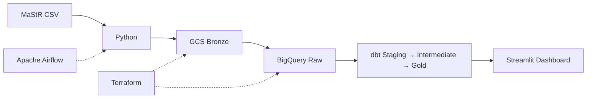

# MaStR Renewable Energy Data Engineering

An end-to-end data engineering project using Germany's [Marktstammdatenregister (MaStR)](https://www.marktstammdatenregister.de/) data.

The project analyzes **wind, solar, biomass, and battery storage infrastructure** across **38 municipalities in Potsdam-Mittelmark, Brandenburg**.

**Business question:** Which municipalities have high renewable energy generation capacity relative to battery storage capacity?

## Architecture

## Tech Stack

| Area | Technologies |
|---|---|
| Ingestion | Python, Poetry |
| Storage & Warehousing | Google Cloud Storage, BigQuery |
| Transformation | dbt |
| Orchestration | Apache Airflow, Docker Compose |
| Infrastructure | Terraform |
| Visualization | Streamlit, Altair, PyDeck |

## Repository Structure

| Directory | Purpose |
|---|---|
| `mastr-data-pipeline/` | Data ingestion, validation, dbt models and tests |
| `mastr-airflow/` | Pipeline orchestration |
| `mastr-infra/` | GCP infrastructure with Terraform |
| `mastr-dashboard/` | Interactive Streamlit dashboard |

## Data Model

Data flows through **Bronze → Raw → Staging → Intermediate → Gold**, producing municipality-level renewable energy and battery storage metrics.

## Deployment Options

The current architecture uses Airflow on Compute Engine.

[How does it compare to a serverless alternative?](mastr-data-pipeline/docs/deployment_options.md)

## Getting Started

Each component has its own setup instructions:

- [Data Pipeline](mastr-data-pipeline/README.md)
- [Airflow](mastr-airflow/README.md)
- [Infrastructure](mastr-infra/README.md)
- [Dashboard](mastr-dashboard/README.md)

The pipeline uses manually downloaded MaStR CSV snapshots and Google Cloud credentials configured locally.
