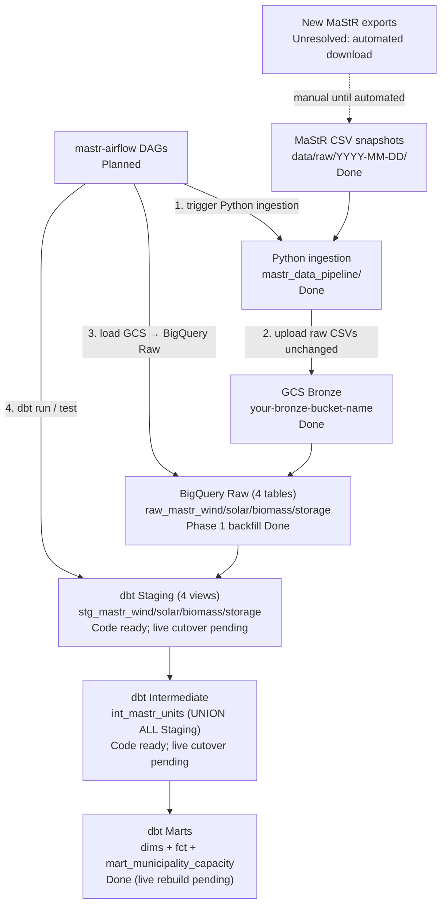

# MaStR pipeline architecture

Minimal, reproducible architecture for Marktstammdatenregister (MaStR) extracts
covering Potsdam-Mittelmark (Brandenburg): wind, solar, biomass, and storage.

Follows Le Wagon Data Engineering layering:

`raw → staging → intermediate → marts`

Orchestration lives in a **separate** repository (`mastr-airflow`).

Related docs:

- `docs/data_validation.md` — source validation and modeling decisions
- `docs/schema.dbml` — star schema ERD
- `docs/migration_four_raw_tables.md` — unified Raw → four Raw tables cutover

---

## Status legend

| Marker | Meaning |
|---|---|
| **Done** | Present in the repo or already executed on the VM / GCP |
| **Planned** | Agreed design; not implemented yet |
| **Unresolved** | Intentionally open; not part of the current build |

---

## High-level data flow



**Airflow responsibilities (planned):** orchestrate Python ingestion to GCS Bronze, BigQuery Raw loading, dbt transformations (staging → intermediate → marts), and data quality tests.

**Unresolved:** automated downloading of new MaStR exports. Until that exists, snapshots are supplied manually under `data/raw/<snapshot_date>/` and mirrored to GCS by ingestion.

---

## Repository responsibilities

| Repository | Role | Owns |
|---|---|---|
| `mastr-data-pipeline` | Data product | CSV snapshots (gitignored), Python ingestion package, dbt models/tests/snapshots, data docs |
| `mastr-airflow` | Orchestration only | DAGs that trigger ingestion, BigQuery loads, dbt, and tests; `package-mode = false` |

Airflow does **not** own transformation SQL. dbt does **not** schedule itself.

---

## Layer purposes and materialization

| Layer | Purpose | Materialization | Status |
|---|---|---|---|
| **GCS Bronze** | Immutable original MaStR CSV bytes, path-labeled by `snapshot_date` | GCS objects | **Done** (snapshot `2026-11-09` uploaded) |
| **BigQuery Raw** (4 tables) | One table per CSV: `raw_mastr_wind` / `_solar` / `_biomass` / `_storage`; German STRING + lineage; legacy `raw_mastr_units` kept during migration | **Tables** (partition by `snapshot_date`) | **Done** (Phase 1 backfill; 32 611 rows) |
| **dbt Staging** | Four source views (`stg_mastr_wind` / `_solar` / `_biomass` / `_storage`); shared DE→EN macro; no unified Staging model | **Views** | **Code ready** (live cutover pending) |
| **dbt Intermediate** | `UNION ALL` of the four Staging views, then energy-source classification, `is_operational`, separate capacity measures | **Views** | **Code ready** (live cutover pending) |
| **dbt Marts** | Star schema + municipality reporting for BI | **Tables** | **Done** (live rebuild pending after Staging cutover) |

Le Wagon practice: keep staging and intermediate as views; materialize marts for stable reporting.

---

## Architecture stages

### 1. MaStR CSV → Python ingestion → GCS Bronze

| Item | Status | Notes |
|---|---|---|
| Local snapshot `data/raw/2026-11-09/` | **Done** | Four CSVs validated (see `docs/data_validation.md`) |
| Python Bronze ingestion package + tests | **Done** | CLI: `poetry run python -m mastr_data_pipeline --snapshot-date …` |
| GCS bucket `your-bronze-bucket-name` | **Done** | `europe-west3`; objects under `bronze/mastr/snapshot_date=…/` |
| Automated MaStR export download | **Unresolved** | Separate from upload |

GCS Bronze objects stay immutable. No cleaning in place on the objects.

### 2. GCS Bronze → BigQuery Raw (four tables)

| Item | Status | Notes |
|---|---|---|
| Dataset `mastr_raw` in `europe-west3` | **Done** | Physical Raw layer |
| Legacy `raw_mastr_units` | **Done (archive)** | Unified table; retained until Staging/Gold cutover is validated |
| Split tables | **Done** (Phase 1) | `raw_mastr_wind` / `_solar` / `_biomass` / `_storage` (32 611 rows) |
| Lineage at load | **Done** | `source_file`, `snapshot_date`, `ingested_at` |
| Idempotent reload | **Code ready** | Per-table delete-then-insert for that `snapshot_date` |

See `docs/migration_four_raw_tables.md` for the live cutover plan.

### 3. dbt Staging → Intermediate → Marts

#### Staging (views) — Code ready (live cutover pending)

- `stg_mastr_wind` / `_solar` / `_biomass` / `_storage` from the four Raw tables
- Shared macro `select_stg_mastr_units` for DE→EN mapping and casts
- No unified Staging model; Intermediate combines the four views

#### Intermediate (views) — Code ready (live cutover pending)

Reusable business logic **before** the star schema (`int_mastr_units`):

- `UNION ALL` of the four Staging views
- Classify energy source: generation vs storage; battery vs hydrogen vs other via storage technology codes
- Derive `is_operational` from status
- Build separate measures: `generation_power_kw`, `storage_power_kw`, `storage_capacity_kwh`

#### Marts (tables) — Done

| Model | Role |
|---|---|
| `dim_municipality` | One row per municipality |
| `dim_energy_source` | English codes + `energy_source_group` |
| `dim_status` | English status + `is_operational` |
| `fct_mastr_units` | Grain `(snapshot_date, unit_id)`; FKs to the three dims |
| `mart_municipality_capacity` | Municipality-level analytical reporting |

**Measure policy:** municipality headlines use **net** power; keep generation kW, storage kW, and storage kWh separate; `gross_power_kw` is audit-only. Mart uses only the latest complete snapshot.

### 4. Airflow orchestration (`mastr-airflow`)

| Item | Status | Notes |
|---|---|---|
| Repo scaffold | **Done** | `dags/`, `scripts/`, `tests/`, Poetry `package-mode = false` |
| DAGs | **Planned** | Python ingest → BigQuery Raw load → dbt run → dbt test |

### 5. Data quality, completeness, future CDC / SCD2

| Item | Status | Notes |
|---|---|---|
| Documented source QA | **Done** | Checksums, ID uniqueness, join readiness |
| Raw load validation + completeness gate | **Planned** | Row counts per `source_file`; four files present |
| dbt tests | **Planned** | Unique `(snapshot_date, unit_id)`, not-null keys, relationships, capacity rules |
| SCD Type 2 / CDC via dbt snapshots | **Planned (design only)** | Hooks in `schema.dbml`; not built yet |

#### Latest complete snapshot

A `snapshot_date` is complete only when:

1. All four expected CSV files loaded successfully into Raw (`wind.csv`, `solar.csv`, `biomass.csv`, `battery.csv`).
2. Actual loaded row counts match the **expected counts for that snapshot** (snapshot-specific; see `docs/data_validation.md`).
3. No failed or incomplete loads.

For snapshot `2026-11-09` only, the expected counts are 278 / 20 861 / 56 / 11 416. Future snapshots will have their own expected counts.

```text
latest_complete_snapshot_date =
  max(snapshot_date) among complete snapshot_dates
```

`mart_municipality_capacity` filters to that date so historical extracts are not double-counted.

---

## Implemented vs planned

| Done | Planned | Unresolved |
|---|---|---|
| Two-repo scaffold + docs (`schema.dbml`, validation, this architecture) | BigQuery Raw dataset/table + load + lineage | Automated MaStR export download |
| Local CSV snapshot `2026-11-09` | dbt Staging views | |
| Python → GCS Bronze ingestion (tested; snapshot uploaded) | dbt Intermediate views | |
| GCS Bronze bucket + IAM (existing SA) | dbt Marts: dims, `fct_mastr_units`, `mart_municipality_capacity` | |
| Completeness / SCD2 **policy** | Airflow DAGs + dbt tests + completeness **implementation** | |

---

## What is explicitly out of scope for v1

- Implementing SCD Type 2 / CDC (design only)
- Mixing generation kW, storage kW, and storage kWh into one metric
- Treating all `Speicher` rows as batteries
- Putting dbt models or business SQL inside `mastr-airflow`
- Mutating CSV objects after landing in GCS
- Assuming every new MaStR export is downloaded automatically

---

## Reproducibility checklist (Le Wagon-oriented)

1. Pin Python via `.python-version` / Poetry in `mastr-data-pipeline`.
2. Keep raw extracts under `data/raw/<snapshot_date>/` locally (gitignored) and mirror them immutably in GCS via ingestion.
3. Record SHA-256 and **snapshot-specific** expected row counts in `docs/data_validation.md` before promoting a snapshot.
4. Load Raw idempotently (delete then load per `snapshot_date`); promote only **complete** snapshots to municipality reporting.
5. Transform with dbt (`staging → intermediate → marts`); orchestrate ingest, BigQuery load, dbt run, and tests with Airflow in the sister repo.
