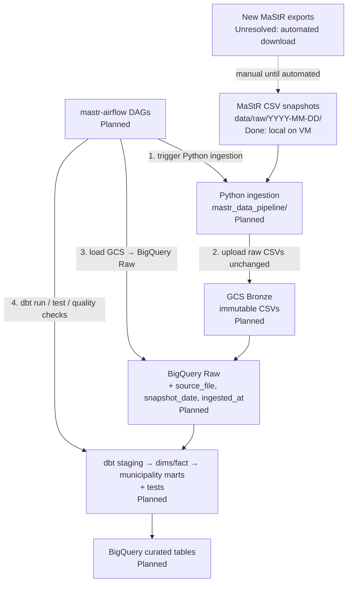

# MaStR pipeline architecture

Minimal, reproducible architecture for Marktstammdatenregister (MaStR) extracts
covering Potsdam-Mittelmark (Brandenburg): wind, solar, biomass, and storage.

Follows Le Wagon Data Engineering layering:

`raw → staging → dimensions / facts → analytical marts`

Orchestration lives in a **separate** repository (`mastr-airflow`).

Related docs:

- `docs/data_validation.md` — source validation and modeling decisions
- `docs/schema.dbml` — star schema ERD

---

## Status legend

| Marker | Meaning |
|---|---|
| **Done** | Present in the repo or already executed on the VM |
| **Planned** | Agreed design; not implemented yet |

---

## High-level data flow



**Airflow responsibilities (planned):** trigger the Python ingestion task that uploads raw MaStR CSVs to GCS Bronze; then orchestrate BigQuery loading, dbt transformations, and data quality checks.

**Unresolved:** automated downloading of new MaStR exports. Until that exists, snapshots are supplied manually under `data/raw/<snapshot_date>/` (and mirrored to GCS by ingestion).

---

## Repository responsibilities

| Repository | Role | Owns |
|---|---|---|
| `mastr-data-pipeline` | Data product | CSV snapshots (gitignored), Python ingestion package, dbt models/tests/snapshots, data docs |
| `mastr-airflow` | Orchestration only | DAGs and scripts that trigger ingestion, BigQuery loads, dbt, and quality checks; `package-mode = false` |

Airflow does **not** own transformation SQL. dbt does **not** schedule itself.

---

## Architecture stages

### 1. MaStR CSV snapshots → Python ingestion → GCS Bronze

| Item | Status | Notes |
|---|---|---|
| Local snapshot folder `data/raw/2026-11-09/` | **Done** | `wind.csv`, `solar.csv`, `biomass.csv`, `battery.csv` |
| Source validation + checksums | **Done** | See `docs/data_validation.md` |
| Project scaffolding (package stub, dbt folders, docs) | **Done** | Ingestion logic not implemented |
| Python ingestion → GCS Bronze | **Planned** | Triggered by Airflow; uploads CSVs unchanged |
| Automated download of new MaStR exports | **Unresolved** | Separate from ingestion upload |

GCS Bronze objects stay immutable. No cleaning in place on the objects.

### 2. GCS → BigQuery Raw (+ ingestion metadata)

| Item | Status | Notes |
|---|---|---|
| Load CSV from GCS into BigQuery raw tables | **Planned** | Orchestrated by Airflow after Bronze upload |
| Attach lineage at load time | **Planned** | `source_file`, `snapshot_date`, `ingested_at` |
| Preserve lineage through dbt | **Planned** | Pass-through in staging/marts |
| Keep GCS CSVs unchanged | **Planned / policy** | Raw files are the source of truth |

### 3. dbt staging → dimensional models → municipality marts

| Layer | Models | Status |
|---|---|---|
| Staging | `stg_mastr_units` — English names, casts, net/gross split, storage classification via `Speichertechnologie` | **Planned** (folders exist) |
| Dimensions | `dim_municipality`, `dim_energy_source`, `dim_status` | **Planned** (ERD done) |
| Fact | `fct_mastr_units` — grain `(snapshot_date, unit_id)` | **Planned** (ERD done) |
| Marts | Municipality-level analytical tables (operational generation kW, storage power kW, storage kWh) | **Planned** |

**Measure policy (agreed):**

- Municipality headlines use **net** power (`Nettonennleistung`).
- Keep separate: `generation_power_kw`, `storage_power_kw`, `storage_capacity_kwh`.
- `gross_power_kw` is audit-only.
- Do not classify every `Energieträger = Speicher` as battery; use `Speichertechnologie` (`battery` vs `hydrogen_storage` vs `other_storage`).

**Municipality marts** always filter to the **latest complete snapshot** (definition below).

### 4. Airflow orchestration (`mastr-airflow`)

| Item | Status | Notes |
|---|---|---|
| Repo scaffold | **Done** | `dags/`, `scripts/`, `tests/`, Poetry `package-mode = false` |
| DAGs | **Planned** | Trigger Python → GCS Bronze; then BigQuery load, dbt run/test, quality checks |

### 5. Data quality, completeness, future CDC / SCD2

| Item | Status | Notes |
|---|---|---|
| Documented source QA | **Done** | Checksums, ID uniqueness, join readiness |
| dbt tests (unique `(snapshot_date, unit_id)`, not-null keys, capacity rules, relationships) | **Planned** |
| Snapshot completeness gate | **Planned** | See below |
| SCD Type 2 / CDC via dbt snapshots (`valid_from`, `valid_to`, `is_current`) | **Planned (design only)** | Hooks in `schema.dbml`; not built yet |

#### Latest complete snapshot

A `snapshot_date` is complete only when:

1. All four expected CSV files loaded successfully (`wind.csv`, `solar.csv`, `biomass.csv`, `battery.csv`).
2. Actual loaded row counts match the **expected counts for that snapshot** (snapshot-specific; recorded per extract in `docs/data_validation.md` or a load manifest).
3. No failed or incomplete loads.

For snapshot `2026-11-09` only, the expected counts are 278 / 20 861 / 56 / 11 416. Future snapshots will have their own expected counts.

Then:

```text
latest_complete_snapshot_date =
  max(snapshot_date) among complete snapshot_dates
```

Municipality aggregations use only that date.

---

## Implemented vs planned

| Done | Planned | Unresolved |
|---|---|---|
| Two-repo scaffold | Python ingestion → GCS Bronze | Automated MaStR export download |
| Local CSV snapshot `2026-11-09` + validation docs | BigQuery Raw load + lineage | |
| ERD (`schema.dbml`) and this architecture doc | dbt staging / dims / fact / marts / tests | |
| Empty package + dbt folder placeholders | Airflow DAGs (ingest → BQ → dbt → tests) | |
| Completeness / SCD2 **policy** | Completeness gate + SCD2 **implementation** | |

---

## What is explicitly out of scope for v1

- Implementing SCD Type 2 / CDC (design only)
- Mixing generation kW, storage kW, and storage kWh into one metric
- Treating all `Speicher` rows as batteries
- Putting dbt models or business SQL inside `mastr-airflow`
- Mutating CSV objects after landing in GCS
- Assuming every new MaStR export is downloaded automatically

---

## Reproducibility checklist (Le Wagon-oriented)

1. Pin Python via `.python-version` / Poetry in `mastr-data-pipeline`.
2. Keep raw extracts under `data/raw/<snapshot_date>/` locally (gitignored) and mirror them immutably in GCS via ingestion.
3. Record SHA-256 and **snapshot-specific** expected row counts in `docs/data_validation.md` (or equivalent) before promoting a snapshot.
4. Promote only **complete** snapshots to municipality reporting.
5. Run transformations with dbt; schedule ingestion, loads, dbt, and tests with Airflow in the sister repo.
