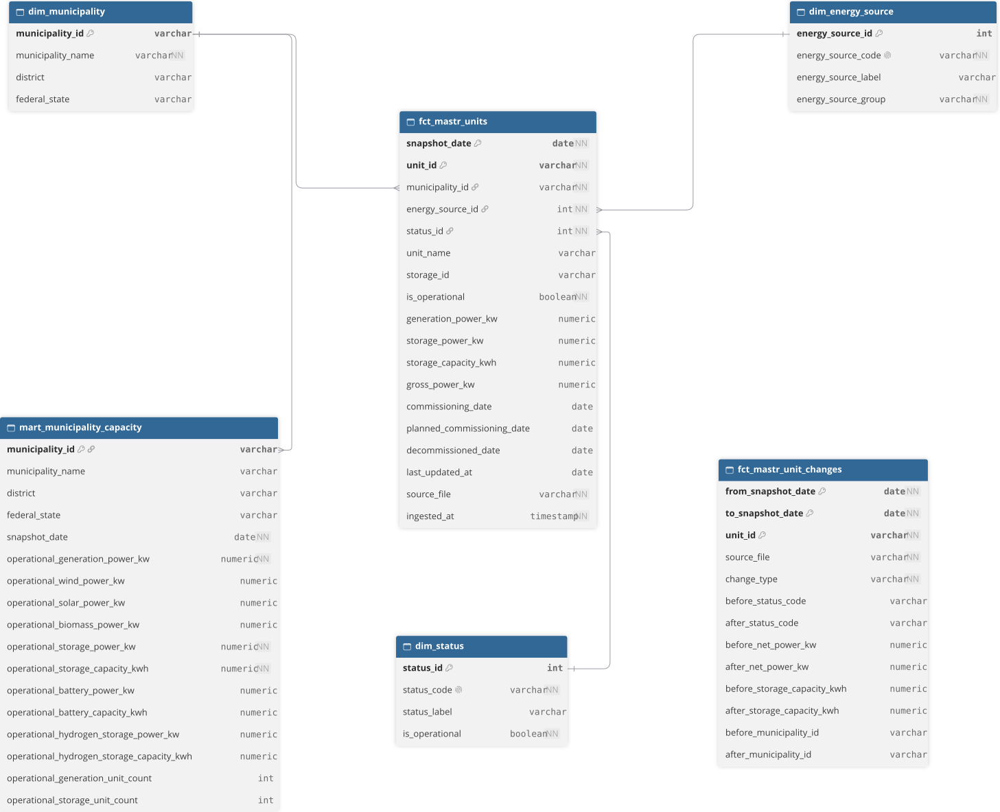

# MaStR Data Pipeline

Python and dbt pipeline processing renewable energy infrastructure data from Germany's Marktstammdatenregister (MaStR).

The pipeline processes **wind, solar, biomass, and battery storage** data for 38 municipalities in Potsdam-Mittelmark.

## Architecture

```text
MaStR CSVs
    ↓
Python validation & ingestion
    ↓
Google Cloud Storage (Bronze)
    ↓
BigQuery Raw
    ↓
dbt Staging → Intermediate → Gold
```

The pipeline includes data-quality tests and snapshot change detection (CDC).

## Setup

**Requirements:** Python 3.12, Poetry, GCP access, and Application Default Credentials (ADC).

From `mastr-data-pipeline/`:

```bash
cp .env.sample .env
poetry install --with dbt
```

Configure `.env` with your GCP project, GCS bucket, BigQuery dataset and location.

Configure the `mastr` dbt profile using [`dbt/profiles.yml.sample`](dbt/profiles.yml.sample) and OAuth authentication.

Place the four source files in:

```text
data/raw/2026-11-16/
├── wind.csv
├── solar.csv
├── biomass.csv
└── battery.csv
```

The snapshot must be registered in `config/snapshots.json`.

## Run Pipeline

Validate the CSV files:

```bash
poetry run python -m mastr_data_pipeline validate-snapshot --snapshot-date 2026-11-16
```

Upload to GCS Bronze:

```bash
poetry run python -m mastr_data_pipeline ingest-bronze --snapshot-date 2026-11-16
```

Load BigQuery Raw:

```bash
poetry run python -m mastr_data_pipeline load-raw --snapshot-date 2026-11-16
```

Run dbt transformations and tests:

```bash
make generate-snapshot-seed
make dbt-seed
make dbt-run
make dbt-test
```

Run Python tests:

```bash
make test
```

The full workflow is also orchestrated by [Apache Airflow](../mastr-airflow/README.md).

## Data Model



BigQuery datasets:

| Layer | Dataset |
|---|---|
| Raw | `mastr_raw` |
| Staging | `mastr_staging` |
| Intermediate | `mastr_intermediate` |
| Gold | `mastr_marts` |

Gold models provide installation-level data, municipality-level capacity comparisons, and snapshot change tracking.

For additional technical details, see [Architecture](docs/architecture.md) and [Data Validation](docs/data_validation.md).