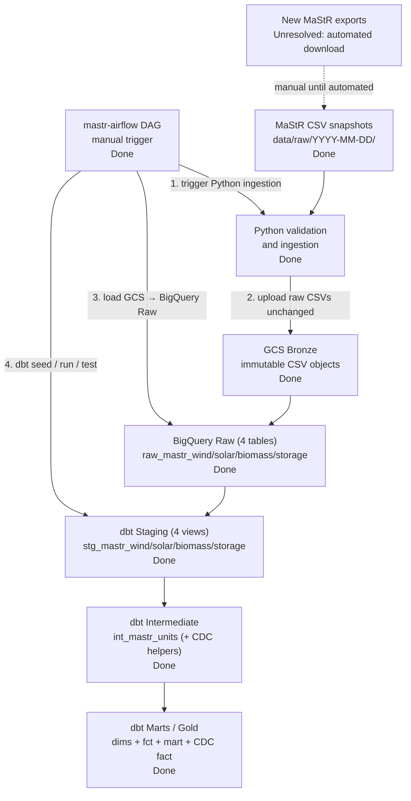

# MaStR pipeline architecture

Minimal, reproducible architecture for Marktstammdatenregister (MaStR) extracts
covering Potsdam-Mittelmark (Brandenburg): wind, solar, biomass, and storage.

Layering:

`raw → staging → intermediate → marts` (Gold)

Orchestration lives in the sibling monorepo directory `mastr-airflow`.

Related docs:

- `docs/data_validation.md` — source validation and modeling decisions
- `docs/schema.dbml` — Gold star schema ERD (dbdiagram.io)
- `docs/migration_four_raw_tables.md` — completed unified → four Raw tables cutover
- Root monorepo README — product overview and getting started

Configuration samples (do not commit filled values):

- `../.env.sample` — `GCP_PROJECT_ID`, `GCS_BUCKET`, `MASTR_RAW_DIR`, `BQ_DATASET`, `BQ_LOCATION`
- `dbt/profiles.yml.sample` — dbt profile template (`method: oauth`)

---

## Status legend

| Marker | Meaning |
|---|---|
| **Done** | Implemented in this repository (and intended for use in a dedicated GCP project) |
| **Deferred** | Agreed design; not required for the current release |
| **Unresolved** | Intentionally open; not part of the current build |

---

## High-level data flow



**Airflow responsibilities:** orchestrate Python ingestion to GCS Bronze, BigQuery Raw loading, dbt seed/run/test (staging → intermediate → marts). The DAG (`mastr_snapshot_pipeline`) is **manual only** (`schedule=None`). It does not download MaStR CSVs.

**Unresolved:** automated downloading of new MaStR exports. Until that exists, snapshots are supplied manually under `data/raw/<snapshot_date>/` and mirrored to GCS by ingestion.

---

## Repository responsibilities

| Directory | Role | Owns |
|---|---|---|
| `mastr-data-pipeline` | Data product | CSV snapshots (gitignored), Python ingestion package, dbt models/tests/seeds, data docs |
| `mastr-airflow` | Orchestration only | DAG that triggers ingestion, BigQuery loads, dbt, and tests; `package-mode = false` |
| `mastr-infra` | GCP provisioning | Terraform for Bronze bucket, BigQuery datasets, additive runtime IAM |
| `mastr-dashboard` | BI PoC | Streamlit read-only Gold views + Geobasis BB map |

Airflow does **not** own transformation SQL. dbt does **not** schedule itself.

---

## Layer purposes and materialization

| Layer | Purpose | Materialization | Status |
|---|---|---|---|
| **GCS Bronze** | Immutable original MaStR CSV bytes, path-labeled by `snapshot_date` | GCS objects under `bronze/mastr/snapshot_date=…/` | **Done** |
| **BigQuery Raw** (4 tables) | One table per CSV: `raw_mastr_wind` / `_solar` / `_biomass` / `_storage`; German STRING + lineage. Backup: `raw_mastr_units` (not written by the loader) | **Tables** (partition by `snapshot_date`) | **Done** |
| **dbt Staging** | Four source views; shared DE→EN macro `select_stg_mastr_units` | **Views** in `mastr_staging` | **Done** |
| **dbt Intermediate** | `UNION ALL` of Staging, classification, measures; snapshot CDC helper view | **Views** in `mastr_intermediate` | **Done** |
| **dbt Marts (Gold)** | Star schema, municipality reporting, CDC change fact | **Tables** in `mastr_marts` | **Done** |

Prefer views for staging/intermediate; materialize marts for stable reporting.

Datasets (product contract, all `europe-west3`): `mastr_raw`, `mastr_staging`, `mastr_intermediate`, `mastr_marts`.
Bronze bucket name and GCP project id come from environment / Terraform variables (see `.env.sample` and `mastr-infra/terraform/terraform.tfvars.sample`).

---

## Architecture stages

### 1. MaStR CSV → Python ingestion → GCS Bronze

| Item | Status | Notes |
|---|---|---|
| Local snapshots under `data/raw/<snapshot_date>/` | **Done** | Four CSVs: `wind.csv`, `solar.csv`, `biomass.csv`, `battery.csv` (gitignored) |
| Snapshot registry `config/snapshots.json` | **Done** | SHA-256, expected row counts, declared `export_scope` |
| Known `2026-11-09` | **Done** | `export_scope: legacy_mixed_filters` (historical exception) |
| Known `2026-11-16` | **Done** | `export_scope: all_statuses` — first CDC-eligible baseline in config |
| Data Contract (`validate-snapshot`) | **Done** | Enforced before Bronze; see `docs/data_validation.md` |
| Python Bronze ingestion + tests | **Done** | CLI: `poetry run python -m mastr_data_pipeline ingest-bronze --snapshot-date …` |
| GCS Bronze upload | **Done** | Create-only objects; bucket via `GCS_BUCKET` |
| Automated MaStR export download | **Unresolved** | Separate from upload |

GCS Bronze objects stay immutable. No cleaning in place on the objects.

### 2. GCS Bronze → BigQuery Raw (four tables)

| Item | Status | Notes |
|---|---|---|
| Dataset `mastr_raw` in `europe-west3` | **Done** | Physical Raw layer (`BQ_DATASET` / `BQ_LOCATION`) |
| Split tables | **Done** | `raw_mastr_wind` / `_solar` / `_biomass` / `_storage` |
| Legacy `raw_mastr_units` | **Done (backup)** | Unified archive; loader and dbt do not use it |
| Lineage at load | **Done** | `source_file`, `snapshot_date`, `ingested_at` |
| Idempotent reload | **Done** | Per-table validate-then-atomic-replace for that `snapshot_date` |

See `docs/migration_four_raw_tables.md` for the completed cutover record.

### 3. dbt Staging → Intermediate → Marts

#### Staging (views) — Done

- `stg_mastr_wind` / `_solar` / `_biomass` / `_storage` from the four Raw tables
- Shared macro `select_stg_mastr_units` for DE→EN mapping and casts
- No unified Staging model; Intermediate combines the four views

#### Intermediate — Done

Reusable business logic **before** the star schema:

| Model | Materialization | Role |
|---|---|---|
| `int_mastr_units` | View | `UNION ALL` of Staging; energy-source classification; `is_operational`; separate capacity measures |
| `cdc_eligible_snapshots` | Ephemeral | Complete snapshots with `export_scope = all_statuses` |
| `int_mastr_unit_cdc` | View | Snapshot CDC across consecutive eligible pairs (includes `UNCHANGED`) |

#### Marts / Gold (tables) — Done

| Model | Role |
|---|---|
| `dim_municipality` | One row per municipality |
| `dim_energy_source` | English codes + `energy_source_group` (from seed) |
| `dim_status` | English status + `is_operational` (from seed) |
| `fct_mastr_units` | Grain `(snapshot_date, unit_id)`; FKs to the three dims |
| `mart_municipality_capacity` | Municipality-level reporting for the latest **complete** snapshot |
| `fct_mastr_unit_changes` | Materialized CDC events (`INSERT` / `UPDATE` / `DELETE_CANDIDATE` only) |
| `complete_snapshots` | Ephemeral completeness helper (not a table) |

Seeds (land in `mastr_staging`): `seed_energy_sources`, `seed_statuses`, `seed_snapshot_expectations`, `seed_snapshot_metadata`.

**Measure policy:** municipality headlines use **net** power; keep generation kW, storage kW, and storage kWh separate; `gross_power_kw` is audit-only. Mart uses only the latest complete snapshot.

### 4. Airflow orchestration (`mastr-airflow`)

| Item | Status | Notes |
|---|---|---|
| Docker Compose stack | **Done** | Postgres + scheduler + webserver; LocalExecutor; keyless ADC mount |
| DAG `mastr_snapshot_pipeline` | **Done** | `check_local_csvs → ingest_bronze → load_raw → generate_snapshot_seed → dbt_seed → dbt_run → dbt_test` |
| Scheduling | **Manual** | `schedule=None`; `max_active_runs=1`; param `snapshot_date` |
| CSV download | **Not implemented** | Operator places files under `data/raw/<snapshot_date>/` |

Configuration: `mastr-airflow/.env.sample` (`GCP_PROJECT_ID`, `GCS_BUCKET`, `BQ_DATASET`, `BQ_LOCATION`, ADC/dbt host paths).

### 5. Data quality, completeness, snapshot CDC, and SCD Type 2

| Item | Status | Notes |
|---|---|---|
| Documented source QA | **Done** | Checksums, ID uniqueness, join readiness |
| Raw load validation | **Done** | Expected counts from `config/snapshots.json` |
| dbt tests | **Done** | Unique keys, not-null, relationships, capacity rules, completeness |
| Snapshot CDC models | **Done** | `int_mastr_unit_cdc` + `fct_mastr_unit_changes`; consecutive complete `all_statuses` pairs only; `legacy_mixed_filters` dates (e.g. `2026-11-09`) never eligible; with one eligible snapshot the CDC fact is empty |
| SCD Type 2 | **Deferred** | Not implemented (e.g. dbt snapshots). Multi-snapshot fact + snapshot CDC cover current needs |

**Snapshot CDC is not SCD Type 2.** CDC compares two observation dates and emits change events. SCD Type 2 would track attribute validity windows (`valid_from` / `valid_to` / `is_current`) and remains out of scope for v1.

#### Latest complete snapshot

A `snapshot_date` is complete only when:

1. All four expected CSV files loaded successfully into Raw (`wind.csv`, `solar.csv`, `biomass.csv`, `battery.csv`).
2. Actual loaded row counts match the **expected counts for that snapshot** (`config/snapshots.json` / `seed_snapshot_expectations`).
3. Raw, Staging, and Intermediate counts agree per `source_file`.

Known expected counts (from config): `2026-11-09` → 278 / 20 861 / 56 / 11 416; `2026-11-16` → 278 / 21 631 / 58 / 11 676. New snapshots must declare `export_scope: all_statuses` in `config/snapshots.json`.

```text
latest_complete_snapshot_date =
  max(snapshot_date) among complete snapshot_dates
```

`mart_municipality_capacity` filters to that date so historical extracts are not double-counted.

---

## Implemented vs deferred / unresolved

| Done | Deferred | Unresolved |
|---|---|---|
| Monorepo scaffold, docs, Airflow DAG (manual) | SCD Type 2 (e.g. dbt snapshots) | Automated MaStR export download |
| Python → GCS Bronze + BigQuery Raw (4 tables) | Production Airflow schedule / CI/CD in this repo | |
| dbt Staging, Intermediate, Marts + tests | Dedicated dashboard read-only identity (infra) | |
| Completeness helpers + snapshot CDC models | | |
| Terraform Bronze bucket + datasets + additive IAM | | |
| Streamlit Gold PoC + Geobasis BB map | | |

---

## What is explicitly out of scope for v1

- SCD Type 2 historization (design deferred; **not** the same as snapshot CDC)
- Mixing generation kW, storage kW, and storage kWh into one metric
- Treating all `Speicher` rows as batteries
- Putting dbt models or business SQL inside `mastr-airflow`
- Mutating CSV objects after landing in GCS
- Assuming every new MaStR export is downloaded automatically
- Claiming a production Airflow schedule or repository CI/CD deployment automation

---

## Reproducibility checklist

1. Pin Python via `.python-version` / Poetry in `mastr-data-pipeline`.
2. Copy `.env.sample` → `.env` and set `GCP_PROJECT_ID`, `GCS_BUCKET`, `MASTR_RAW_DIR`, `BQ_DATASET`, `BQ_LOCATION` (leave keyfile-based credentials unset; prefer ADC).
3. Keep raw extracts under `data/raw/<snapshot_date>/` locally (gitignored) and mirror them immutably in GCS via ingestion.
4. Record SHA-256, **snapshot-specific** expected row counts, and `export_scope` in `config/snapshots.json` (and regenerate seeds) before promoting a snapshot.
5. Load Raw idempotently (validate then replace per `snapshot_date`); promote only **complete** snapshots to municipality reporting.
6. Transform with dbt (`staging → intermediate → marts`); optionally orchestrate with Airflow in `mastr-airflow` (manual DAG trigger).
