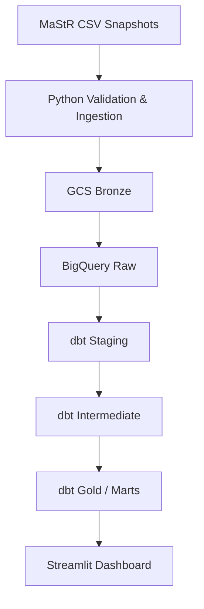
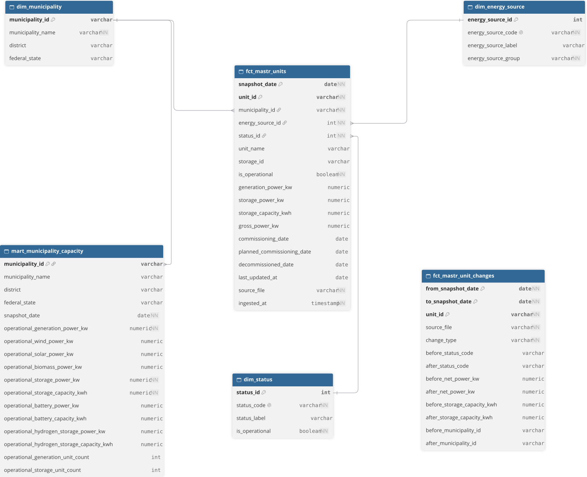

# MaStR Pipeline Architecture

The MaStR pipeline processes wind, solar, biomass, and battery storage data for Potsdam-Mittelmark, Germany.

## Data Flow

Apache Airflow orchestrates the pipeline using the manually triggered `mastr_snapshot_pipeline` DAG.

Terraform manages the GCS Bronze bucket, BigQuery datasets, and runtime IAM permissions.

## Data Layers

| Layer | Dataset | Purpose |
|---|---|---|
| Bronze | GCS | Original CSV snapshots |
| Raw | `mastr_raw` | Four source tables |
| Staging | `mastr_staging` | Cleaning, type conversion, German-to-English mapping |
| Intermediate | `mastr_intermediate` | Unified installation data and CDC |
| Gold | `mastr_marts` | Dimensions, facts, and municipality-level metrics |

## Main dbt Models

| Model | Purpose |
|---|---|
| `stg_mastr_wind`, `stg_mastr_solar`, `stg_mastr_biomass`, `stg_mastr_storage` | Source transformations |
| `int_mastr_units` | Combines renewable energy installations |
| `int_mastr_unit_cdc` | Detects changes between eligible snapshots |
| `fct_mastr_units` | Installation-level fact table |
| `fct_mastr_unit_changes` | Snapshot change events |
| `mart_municipality_capacity` | Municipality generation and storage comparisons |
| `dim_municipality`, `dim_energy_source`, `dim_status` | Reference dimensions |

## Data Quality

The pipeline validates CSV schemas, checksums, row counts, identifiers, and geographic filters before ingestion.

dbt tests verify uniqueness, relationships, completeness, and capacity rules.

Municipality reporting uses the **latest complete snapshot**.

Snapshot CDC compares consecutive complete snapshots marked `all_statuses` in `config/snapshots.json`.

## Data Model

For execution instructions, see the [Data Pipeline README](../README.md).