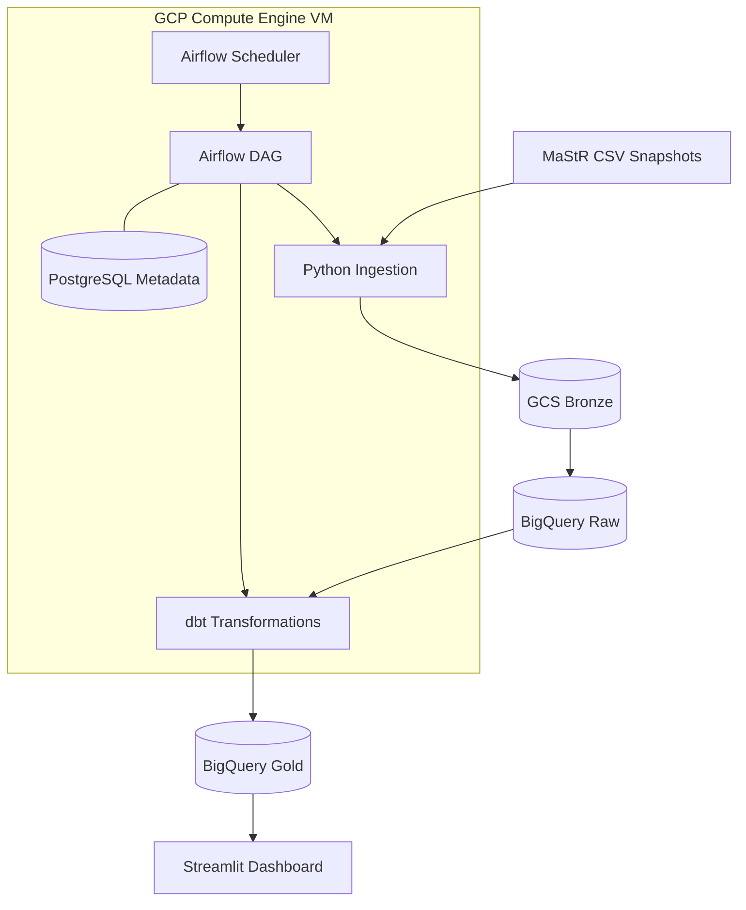
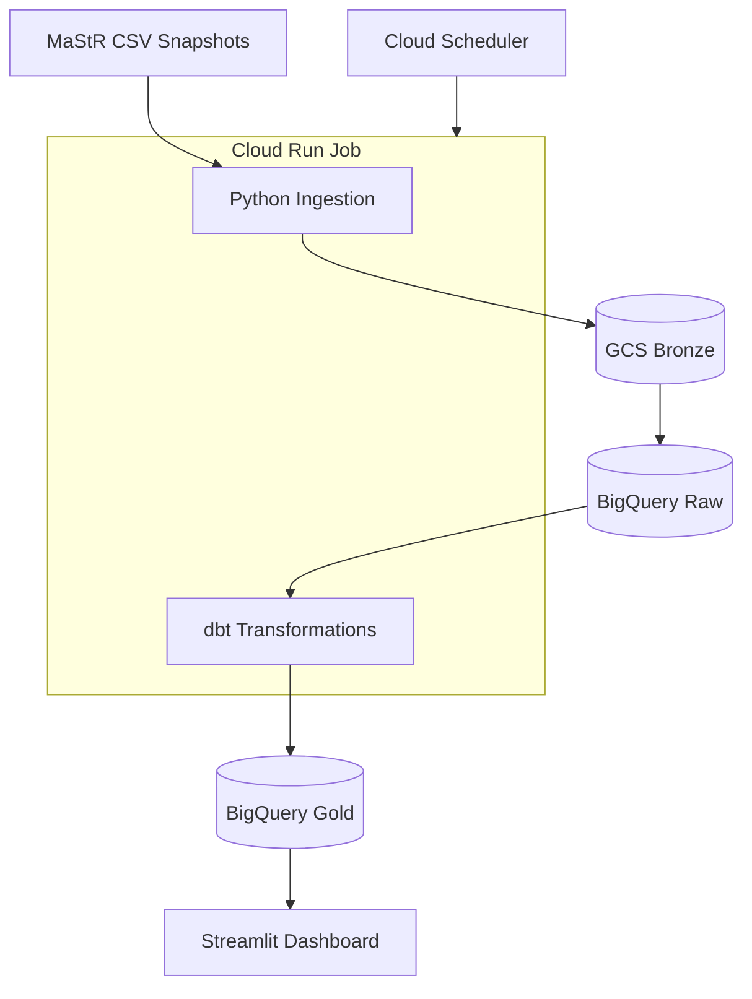

# Deployment Architecture Options

## Objective

Compare two architectures for automated MaStR pipeline execution in terms of cost, scalability, maintenance and implementation effort.

## Option A — Self-managed Airflow on GCP

Apache Airflow schedules and orchestrates the existing pipeline on a continuously running Compute Engine VM using Docker Compose and PostgreSQL.

## Option B — Serverless GCP

Cloud Scheduler triggers a containerized Cloud Run Job that executes the pipeline on demand, eliminating the need for a dedicated orchestration VM.

## Technical Comparison

| Criteria | Airflow on GCP VM | Cloud Scheduler + Cloud Run Jobs |
|---|---|---|
| Infrastructure | Compute Engine | Serverless |
| Execution | VM-based | On demand |
| Orchestration | Airflow DAG | Scheduler + execution logic |
| Monitoring | Airflow UI | Cloud Logging |
| Scalability | VM-dependent | Managed |
| Reproducibility | Docker Compose + Terraform | Container images + Terraform |
| Maintenance | Higher | Lower |
| Implementation effort (from scratch) | Higher | Lower |
| Migration effort (current project) | Minimal | Moderate |
| Retry management | Task-level | Job-level |
| Cost model | VM uptime and allocated resources | Execution duration and resource consumption |

Implementation and migration effort are theoretical estimates based on the current project architecture.

| Architecture | Cost Assumptions |
|---|---|
| Airflow on GCP VM | Based on VM uptime and allocated resources. |
| Cloud Scheduler + Cloud Run Jobs | Based primarily on execution duration and resource consumption. |

GCS, BigQuery and dashboard hosting costs are additional.

These assumptions have not been validated against actual usage or billing data.

Estimates are hypothetical and have not been validated against actual usage or current pricing. GCS, BigQuery, container registry and dashboard hosting costs are excluded.

## Implementation Considerations

Both architectures retain the existing Python pipeline, dbt models, GCS and BigQuery infrastructure.

The serverless alternative requires changes to Docker, Terraform, IAM and workflow execution logic.

Both options require automated MaStR data acquisition for fully automated execution.

## Conclusion

Airflow offers greater orchestration flexibility, task-level monitoring and dependency management.

The serverless architecture offers lower infrastructure overhead and potentially lower costs for periodic batch workloads.

The final decision depends on workload frequency, measured execution costs and orchestration requirements.

